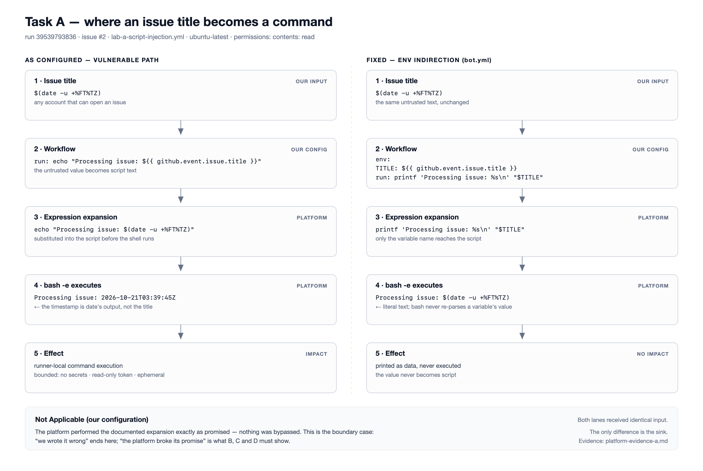

# Task A — Script injection through an issue title

**Classification: Not Applicable (our configuration).** This section marks the
boundary between a defect in our workflow and a platform failure; it is the
control case the other findings are measured against.

## Configuration under test

`.github/workflows/lab-a-script-injection.yml` — trigger and the only step:

```yaml
on:
  issues: { types: [opened] }
permissions:
  contents: read

jobs:
  vulnerable-echo:
    runs-on: ubuntu-latest
    steps:
      - run: echo "Processing issue: ${{ github.event.issue.title }}"
```

## Assumption

GitHub evaluates `${{ ... }}` and substitutes the result into the `run:` script
*before* handing that script to the shell. The issue title is attacker-controlled
text. If the assumption holds, the title is not data — it is shell source code.

## Evidence

**Setup.** A public repository carrying the workflow on its default branch,
with Actions enabled, no repository secrets, and the job restricted to
`permissions: contents: read`.

**Input.** Issue #2, titled `$(date -u +%FT%TZ)`, opened by the repository
owner. Opening an issue is the only permission involved, and on a public
repository any account that can open an issue reaches the same trigger.

**Response.** Run #1 completed in 2s. The step log contains:

```text
Run echo "Processing issue: $(date -u +%FT%TZ)"
Processing issue: 2026-10-21T03:39:45Z
```

Two things follow from those lines:

1. The script GitHub echoes is already `echo "Processing issue: $(date ...)"`.
   `${{ github.event.issue.title }}` is gone — the substitution happened before
   execution, not inside the shell.
2. The command substitution ran: the timestamp is `date`'s output, not the
   literal title. Arbitrary command execution follows from that.

The same issue event also triggered `bot.yml`, which was **skipped**: its `if:`
requires `@bot` in the body, and it passes user text through `env:` rather than
into the script. Same input, different handling, no execution — the safe
counterpart reacting to the same stimulus.



*Figure 1 — Both lanes start from identical input. The left lane ends in command
execution; the right lane ends in data.*

## How verified

Two sources, kept deliberately separate:

- **Platform** — the run and issue above, recorded with URLs in
  [`platform-evidence-a.md`](platform-evidence-a.md).
- **Local model** — [`repro-a-injection.py`](repro-a-injection.py) extracts the
  real `run:` block, performs the same textual substitution, and executes the
  result with `bash -e` (GitHub's default Linux shell). It reproduces the
  behaviour deterministically and covers two details one online run cannot
  show: the canonical `$(echo injected > proof.txt)` payload leaves the log
  line blank, and quoting the interpolation does not prevent execution.

The harness does not *prove* that GitHub substitutes. Its job is to isolate the
second half of the chain so that the online run only has to prove the first.

## Failure / attack condition

Any account able to open an issue on the repository — no fork, no pull
request, no write permission, no approval step. (The recorded run was made by
the owner; the "any account" reach follows from the repository being public
rather than from a second measurement, and is stated as such.)

## Impact

Bounded, and stated conservatively:

- Arbitrary command execution on the runner, as the `runner` user.
- **No credential exposure.** The job carries no secrets, and its
  `GITHUB_TOKEN` is restricted to `contents: read`.
- No persistence — the runner is ephemeral.
- Command output is emitted to the log unmasked (the timestamp above is
  `date`'s output), so anything the job can read can leave through the log.

This is not a credential-theft finding, and is not presented as one.

## Fix

```yaml
- env:
    TITLE: ${{ github.event.issue.title }}
  run: printf 'Processing issue: %s\n' "$TITLE"
```

`bot.yml` already uses this shape.

Quoting the existing line is **not** a fix: the fixture is already
double-quoted and the payload still executed (local case A2), because expansion
happens before quoting has any effect. The fix is to stop the value being
script at all.

## Residual risk

- The variable is safe only while it stays data. A later `eval`, an unquoted
  expansion, or interpolation into another command string reopens the hole.
- `permissions: contents: read` bounds the blast radius but does not prevent
  execution — defence in depth, not the remediation.
- The log remains an output channel for anything the job can read, so the
  masking of secrets is irrelevant here; the risk is data the job legitimately
  holds.

## Why this is Not Applicable

GitHub documents the hazard and prescribes the env-indirection pattern ([Security
hardening for GitHub Actions — understanding the risk of script
injections](https://docs.github.com/en/actions/security-for-github-actions/security-guides/security-hardening-for-github-actions#understanding-the-risk-of-script-injections)).
The platform did exactly what it says it does; nothing was bypassed. The
correct classification is "our configuration error", and its value to the
report is definitional: it fixes where "we wrote it wrong" ends and "the
platform broke its promise" begins — which is what the B, C and D findings have
to demonstrate.

Reproduction material: [`README.md`](README.md),
[`evidence-a-local.txt`](evidence-a-local.txt),
[`platform-evidence-a.md`](platform-evidence-a.md).
